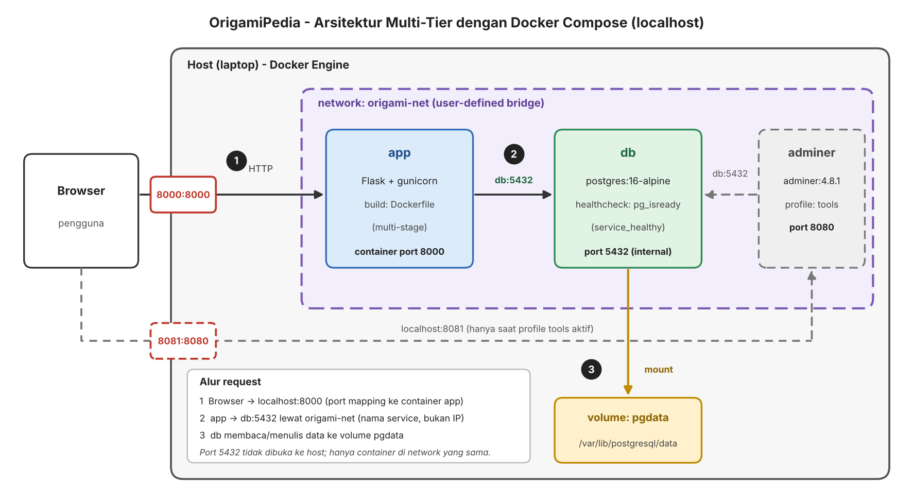
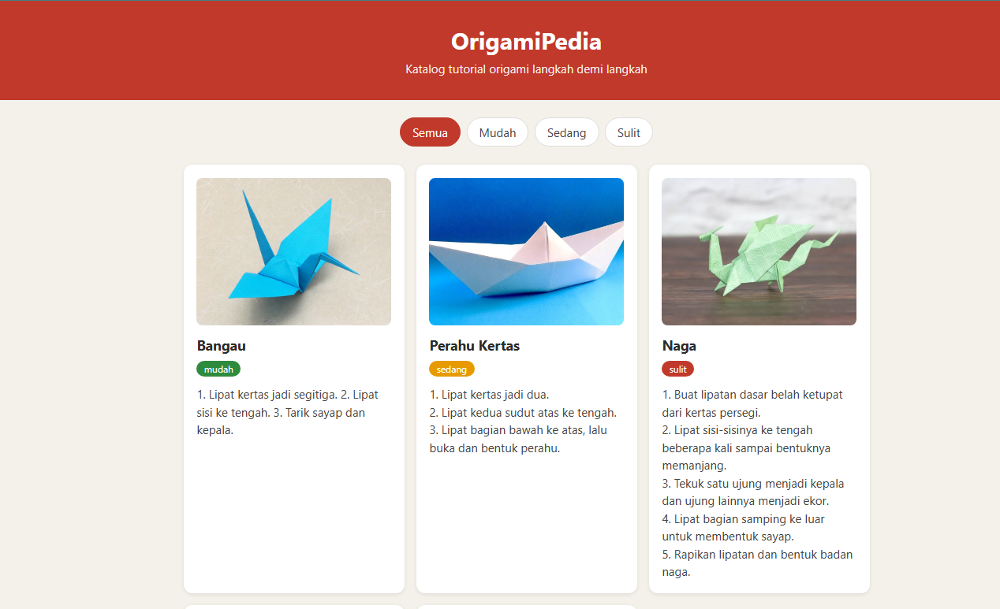
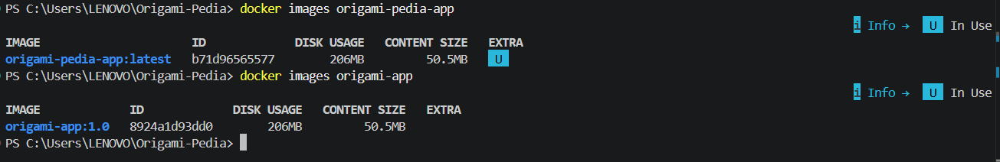
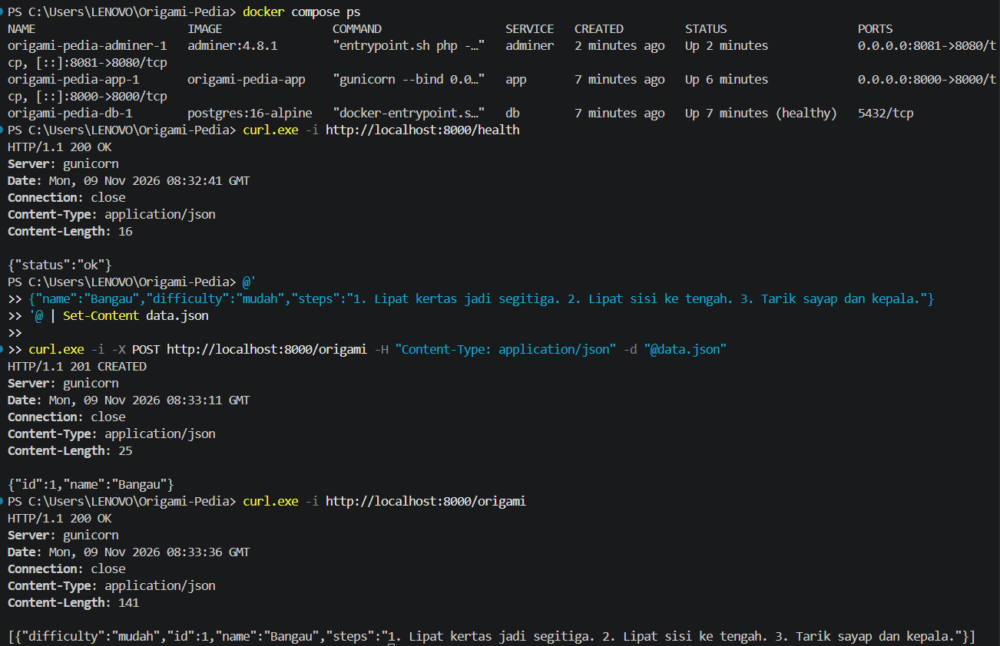
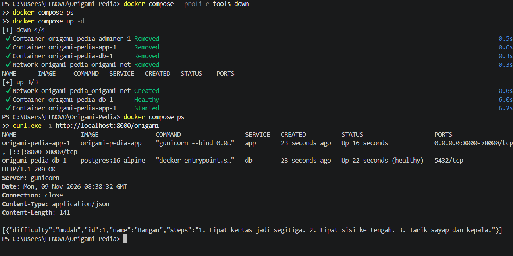
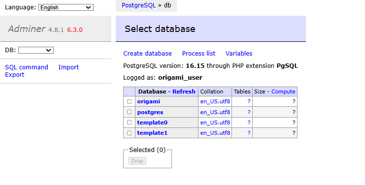

# OrigamiPedia

Katalog tutorial origami berbasis web dengan filter tingkat kesulitan
dan panduan langkah demi langkah. Dibuat untuk UTS Cloud Services (COMP6991031).

## Deskripsi dan alasan proyek
Tutorial origami biasanya tersebar di video dan blog sehingga pemula sulit menemukan panduan yang berurutan dan sesuai level.
OrigamiPedia mengumpulkannya dalam satu katalog dengan filter tingkat kesulitan (mudah, sedang, sulit).
[Tambahkan 1-2 kalimat alasan pribadimu memilih topik ini, dan kaitannya dengan peran karier yang kamu tuju]

## Arsitektur
- `app`: Flask + Gunicorn, port 8000 (frontend dan backend)
- `db`: PostgreSQL 16, data disimpan di named volume `pgdata`, tidak dibuka ke host
- `adminer`: antarmuka database, hanya aktif di profile `tools`, port 8081
- Network: `origami-net`



## Endpoint
| Method | Path | Fungsi | Status |
|---|---|---|---|
| GET | /health | Cek aplikasi | 200 |
| GET | /origami | Daftar origami (`?difficulty=mudah`) | 200 |
| POST | /origami | Tambah origami (`image` opsional) | 201 / 400 |
| GET | / | Halaman web katalog | 200 |

## Cara menjalankan
```bash
git clone https://github.com/marvin173-digital/Origami-Pedia.git
cd Origami-Pedia
cp .env.example .env        # PowerShell: copy .env.example .env
docker compose up -d --build
```
Buka http://localhost:8000. Untuk Adminer:
`docker compose --profile tools up -d`, lalu buka http://localhost:8081.

## Screenshot






## Sumber dan atribusi
- Library dan tools open-source: Flask, Gunicorn, psycopg2, PostgreSQL, dan Adminer.
- Gambar origami di `static/images/`:
  - Rabbit: https://www.thecraftfantastic.co.uk/tutorials/
  - Turtle: https://www.facebook.com/SarjigamiOrigamiArt/posts/origami-sea-turtle-tutorial-is-available-now/1528111386027542/
  - Naga : https://www.gathered.how/papercraft/origami/easy-origami-dragon-tutorial
  - boat : https://www.youtube.com/watch?v=khuVGbCE0PY
  - crane : https://web-japan.org/kidsweb/virtual/origami/exploring02f.html
- Teks langkah tutorial ditulis sendiri.

## Tautan
- Artikel: [isi nanti]
- Video: [isi nanti]

## AI Usage Declaration
- **Alat:** Claude (Anthropic)
- **Bagian yang dibantu AI:**
  - Brainstorming topik dan penyempitan fitur inti
  - Kerangka jawaban Soal 1
  - Kerangka kode `app.py`, `requirements.txt`, dan halaman `index.html` (termasuk CSS dan filter)
  - `Dockerfile`, `.dockerignore`, dan `docker-compose.yml`
  - Kode penambahan kolom dan gambar (`image`)
  - Diagram arsitektur (draf visual)
  - Panduan perintah terminal (Git, Docker, curl) dan debugging error: port 8080 bentrok, kesalahan YAML, login Adminer
  - Kerangka README dan penjelasan bukti
- **Contoh prompt utama:**
  1. "kalau aku bikin proyek web aja kalau web buat tutorial semua kertas origami gmn?"
  2. "sekarang buatkan arsitektur diagram"
  3. "bisa tolong tambahin ini diwebsite gmn caranya?"
  4. Menempelkan pesan error terminal dan bertanya cara memperbaikinya
- **Bagian yang saya kerjakan sendiri:** [periksa dan sesuaikan: memilih topik, menjalankan semua perintah di terminal, pengujian dan screenshot, menulis langkah tutorial origami, menyiapkan gambar, menulis ulang bagian alasan di Soal 1, membuat video dan artikel, serta memahami dan menjelaskan Dockerfile dan docker-compose.yml]